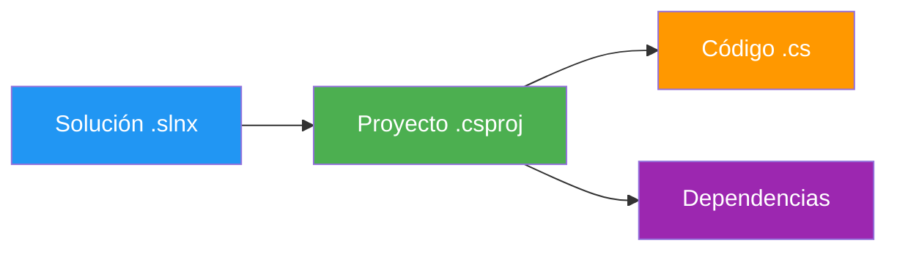
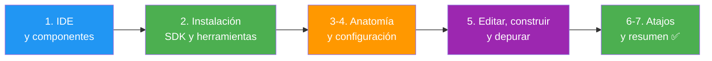
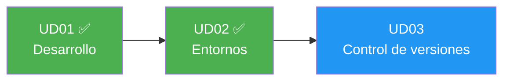

<div class="flex items-center gap-4 w-full">
  
  <span class="ud-pill">Entornos de Desarrollo · 1DAW · Curso 2026-2027</span>
</div>

# Entornos de desarrollo

### Prepara tus herramientas y crea tu primer programa

<div class="mt-10 flex items-end justify-between w-full">
  <div class="text-left">
    <b class="text-lg">José Luis González Sánchez</b><br/>
    <span class="opacity-70">IES Luis Vives · Leganés · <a href="https://joseluisgs.dev">joseluisgs.dev</a></span>
  </div>
  <PacMan :size="54" label="Preparando el entorno..." />
</div>

---

## 📦 Materiales de la unidad

Todo el material de la UD02 está publicado en el repositorio de GitHub, organizado por carpetas:

<div class="grid grid-cols-2 gap-6 items-start">
<div>

- 📚 **7 puntos** — teoría y repaso
- 📝 **Prácticas** — instalación y uso del entorno en `practicas/`
- 🖼️ **Imágenes y recursos** — diagramas y capturas en `images/`
- ⌨️ **Tarjetas de atajos** — referencias en `keymaps/`
- 🎬 **Vídeos** — lista de reproducción en YouTube

</div>
<div class="flex flex-col items-center justify-center gap-4 pt-4">

<RepoBadge caption="Repositorio con materiales de la unidad" />

<div class="text-sm opacity-75 text-center max-w-55">

Clónalo, forquéalo o descárgalo en zip: el material siempre está a un clic.

</div>

</div>
</div>

---

## 🎯 Resultados de aprendizaje: RA 2

<RaaCcee
  code="RA 2"
  title="Evalúa entornos integrados de desarrollo analizando sus características para editar código fuente y generar ejecutables."
  :ccee="[
    'Se han instalado entornos de desarrollo, propietarios y libres.',
    'Se han añadido y eliminado módulos en el entorno de desarrollo.',
    'Se ha personalizado y automatizado el entorno de desarrollo.',
    'Se ha configurado el sistema de actualización del entorno de desarrollo.',
    'Se han generado ejecutables a partir de código fuente de diferentes lenguajes en un mismo entorno de desarrollo.',
    'Se han generado ejecutables a partir de un mismo código fuente con varios entornos de desarrollo.',
    'Se han identificado las características comunes y específicas de diversos entornos de desarrollo.',
  ]"
/>

---

## 📚 Índice: los 7 puntos del tema

<div class="grid grid-cols-4 gap-3 text-sm">

<TopicCard :num="1" title="Introducción a los IDE" desc="Componentes y funciones" />
<TopicCard :num="2" title="Instalación de herramientas" desc="SDK, IDE y Git" />
<TopicCard :num="3" title="Anatomía de los IDEs" desc="Conoce cada zona" />
<TopicCard :num="4" title="Configuración y personalización" desc="Plugins, ajustes y actualizaciones" />
<TopicCard :num="5" title="Operativa básica" desc="Editar, compilar y depurar" />
<TopicCard :num="6" title="Atajos de teclado" desc="Trabaja con fluidez" />
<TopicCard :num="7" title="Resumen y conclusiones" desc="Mapa, errores y checklist" />

</div>

---
layout: section
---

<div class="ud-section-number">01</div>

# Introducción a los IDE

<div class="opacity-70">Herramientas integradas para desarrollar software</div>

---

## 1 · Punto de partida

<div class="grid grid-cols-2 gap-5 items-start">
<div>

<TipBox type="consejo" title="Punto de partida">

¿Puedes programar con un editor de texto? Sí. ¿Y si además tienes compilación, depuración y Git en la misma ventana?

</TipBox>

<TipBox type="nota">

Un **IDE integra** herramientas como el editor, la compilación, la depuración y el control del proyecto.

</TipBox>

</div>
<div>

<Objetivos :items="[
  'Definir qué es un entorno de desarrollo integrado',
  'Distinguir IDE, editor y herramientas externas',
  'Identificar editor, compilación y depuración',
  'Relacionar proyectos, Git, terminal y plugins',
]" />

</div>
</div>

---

## 🧰 ¿Qué es un IDE?

Un **IDE** integra herramientas para desarrollar; un editor extensible incorpora funciones mediante extensiones.

<div class="grid grid-cols-2 gap-5 items-start">
<div>

<ConceptCard icon="🖥️" title="IDE" accent="blue">

Integra editor, construcción, depuración y gestión del proyecto. **Rider**, por ejemplo, está orientado al desarrollo con .NET.

</ConceptCard>

En Rider puedes abrir una solución y compilarla sin salir del entorno.

</div>
<div>

<ConceptCard icon="🧩" title="Editor extensible" accent="green">

VS Code añade soporte de lenguajes y depuración mediante extensiones. Necesita el **SDK** correspondiente para construir un proyecto.

</ConceptCard>

En VS Code eliges las extensiones y herramientas que necesita cada proyecto.

</div>
</div>

<TipBox type="nota">

El IDE **no sustituye al SDK**: configura y utiliza las herramientas necesarias para el lenguaje.

</TipBox>

---

## 🔗 Herramientas integradas frente a herramientas sueltas

<div class="grid grid-cols-2 gap-5 items-start">
<div>

**Sin integrar las herramientas:**

1. Editas el archivo en un editor.
2. Abres una terminal y compilas.
3. Buscas el error y vuelves al editor.

</div>
<div>

**Con un IDE:**

1. Editas y ves los avisos en el código.
2. Compilas desde el propio proyecto.
3. Saltas del error a la línea afectada.

</div>
</div>

<TipBox type="nota">

El IDE organiza el flujo de trabajo, pero los mismos compiladores y SDK pueden utilizarse también desde una terminal.

</TipBox>

---

## 🧭 Un entorno para cada necesidad

| Tipo | Característica | Ejemplo |
|---|---|---|
| **Centrado en una tecnología** | Herramientas adaptadas a su ecosistema | Rider para .NET |
| **Políglota** | Permite trabajar con varios lenguajes | VS Code con extensiones |
| **Especializado** | Añade herramientas de una plataforma | Android Studio |

<TipBox type="consejo">

La frontera no es rígida: un IDE puede especializarse en una tecnología y admitir otros lenguajes mediante plugins.

</TipBox>

---

## 🧭 ¿Dónde interviene el IDE?


<TipBox type="nota">

El IDE destaca en **codificación**, pero también ayuda con pruebas, control de versiones y mantenimiento.

</TipBox>

---

## 🧩 Los componentes del IDE

<div class="grid grid-cols-2 gap-5 items-start">
<div>

| Herramienta | Para qué sirve |
|---|---|
| **Editor** | Escribir y comprender código |
| **Build** | Construir el proyecto |
| **Depurador** | Detener e inspeccionar |
| **Proyecto** | Organizar archivos y dependencias |

</div>
<div>

| Herramienta | Para qué sirve |
|---|---|
| **Terminal** | Ejecutar comandos |
| **Git** | Registrar cambios y colaborar |
| **Refactorización** | Mejorar la estructura |
| **Plugins** | Ampliar funciones |

</div>
</div>

---

## ✍️ El editor te acompaña

<div class="grid grid-cols-2 gap-5 items-start">
<div>

```csharp
int cantidad = 3;
decimal precio = 4.50m;
Console.WriteLine(cantidad * precio);
```

El editor distingue los tipos y los valores mediante colores. Al escribir `Console.`, puede sugerir `WriteLine` y mostrar información sobre sus parámetros.

</div>
<div>

<ConceptCard icon="💡" title="Ayuda mientras escribes" accent="green">

- **Resaltado** de sintaxis
- **Autocompletado** y documentación
- **Análisis** y avisos
- Correcciones y navegación

</ConceptCard>

</div>
</div>

---

## 🏗️ Construir y ejecutar no es lo mismo

Antes de probar un programa, necesitamos preparar sus archivos de salida. Después, al ejecutarlo, comprobamos qué hace con los datos que recibe.

<div class="grid grid-cols-2 gap-5 items-start">
<div>

<ConceptCard icon="🔨" title="Build" accent="blue">

El SDK compila el código y prepara los archivos de salida del proyecto. Si encuentra errores de compilación, los muestra para que puedas corregirlos.

</ConceptCard>

Por ejemplo, `dotnet build` detecta si falta una variable o hay una instrucción incorrecta.

</div>
<div>

<ConceptCard icon="▶️" title="Run" accent="green">

Ejecuta la aplicación con la configuración seleccionada; puede compilar antes. Así puedes observar su comportamiento y comprobar el resultado.

</ConceptCard>

Con `dotnet run` observamos la salida y verificamos si el cálculo devuelve lo esperado.

</div>
</div>

<TipBox type="advertencia">

Un proyecto puede **compilar** y aun así tener errores de lógica al ejecutarse.

</TipBox>

---

## 🔍 ¿Qué ve el editor mientras escribes?

<div class="grid grid-cols-2 gap-5 items-start">
<div>

```csharp
string nombre = "Ana";
Console.WriteLine(nombre);
```

El resaltado ayuda a distinguir tipos, cadenas y llamadas. El autocompletado sugiere miembros disponibles al escribir.

</div>
<div>

Si escribes mal un nombre, el IDE puede marcarlo antes de compilar. Al situar el cursor sobre un aviso, muestra información y, a veces, una **corrección rápida**.

<TipBox type="advertencia">

Un aviso no siempre es un error de compilación. Lee el mensaje antes de aplicar una sugerencia.

</TipBox>

</div>
</div>

---

## 🐞 El depurador: para y observa

1. Coloca un **breakpoint** en el margen del editor.
2. Inicia la aplicación en modo **Debug**.
3. Inspecciona las variables al detenerse.
4. Avanza paso a paso o continúa la ejecución.

<TipBox type="truco">

El depurador te ayuda a comprobar **qué ocurre de verdad**, no solo lo que esperabas que ocurriera.

</TipBox>

---

## 🔀 Proyecto, terminal y Git

<div class="grid grid-cols-2 gap-5 items-start">
<div>

- El **explorador** organiza solución, proyectos y archivos.
- La **terminal integrada** ejecuta `dotnet`, `git` y otros comandos.
- El SDK y Git deben estar instalados y disponibles.

</div>
<div>

<ConceptCard icon="📚" title="Historial del proyecto" accent="purple">

Git registra cambios mediante **commits**. La interfaz del IDE facilita las operaciones, pero no reemplaza los conceptos de Git.

</ConceptCard>

</div>
</div>

---

## 🔧 Refactorizar y ampliar

Al trabajar en un proyecto, conviene separar dos tareas: **mejorar el código que ya existe** y **añadir capacidades al IDE**. Para la primera usamos refactorizaciones; para la segunda, plugins o extensiones.

<div class="grid grid-cols-2 gap-5 items-start">
<div>

<ConceptCard icon="🧹" title="Refactorizar" accent="blue">

Renombra un símbolo o extrae un método para mejorar la estructura **sin cambiar el comportamiento**. El IDE localiza los usos afectados para que puedas revisarlos.

</ConceptCard>

</div>
<div>

<ConceptCard icon="🧩" title="Plugins" accent="green">

Añaden funciones, lenguajes o integración con herramientas. Se pueden instalar, desactivar y eliminar desde el gestor de plugins del entorno.

</ConceptCard>

</div>
</div>

<div class="grid grid-cols-2 gap-5 items-start mt-4">
<div>

**Ejemplo:** al renombrar `total` como `importeTotal`, la refactorización actualiza las referencias del proyecto. Después, revisa los cambios y ejecuta el programa o las pruebas para comprobar que mantiene el mismo comportamiento.

</div>
<div>

**Ejemplo:** una extensión de C# en VS Code aporta análisis y navegación del lenguaje. Instálala desde el Marketplace, revisa quién la publica y comprueba que es compatible con tu versión del editor.

</div>
</div>

---

## 🏅 Herramientas del curso

| Herramienta | En qué destaca | Papel en el curso |
|---|---|---|
| **JetBrains Rider** | C# y .NET | IDE principal |
| **IntelliJ IDEA** | Java y Kotlin | IDE para proyectos Java |
| **VS Code** | Editor extensible y multiplataforma | Alternativa ligera |

<TipBox type="consejo">

Elige según **lenguaje, SDK y necesidades del proyecto**. Conocer más de un entorno te ayuda a comparar.

</TipBox>

---

## Resumen del punto 1

<div class="grid grid-cols-2 gap-5 items-start">
<div>

| Concepto | Función |
|---|---|
| **IDE** | Reúne herramientas de desarrollo |
| **Editor** | Escritura y análisis |
| **Build / Debug** | Construcción e inspección |
| **Proyecto / Git** | Organización e historial |
| **Plugins** | Funcionalidad adicional |

</div>
<div>

<ConceptCard icon="✅" title="Buenas prácticas" accent="green">

- Identifica las herramientas que utiliza el IDE
- Aprende a usar el depurador
- Usa Git desde el principio
- Instala solo los plugins necesarios

</ConceptCard>

<div class="mt-3">

**⏭️ ¿Qué viene después?** En el **punto 2** instalaremos las herramientas del curso.

</div>

</div>
</div>

---
layout: section
---

<div class="ud-section-number">02</div>

# Instalación de herramientas

<div class="opacity-70">Instala y verifica las herramientas necesarias</div>

---

## 2 · Punto de partida

<div class="grid grid-cols-2 gap-5 items-start">
<div>

<TipBox type="consejo" title="Punto de partida">

Tienes instalado Rider, pero no puedes compilar C#. ¿Has instalado y seleccionado el **.NET SDK**?

</TipBox>

<TipBox type="nota">

El **SDK** aporta las herramientas específicas para desarrollar con una tecnología. El **IDE** las localiza y facilita su uso.

</TipBox>

</div>
<div>

<Objetivos :items="[
  'Instalar y verificar los SDK de .NET y Java',
  'Preparar Rider, IntelliJ IDEA y VS Code',
  'Instalar Git y conocer herramientas opcionales',
  'Crear una solución y gestionar paquetes .NET',
]" />

</div>
</div>

---

## 📦 SDK y runtime: cada uno tiene su papel

Para crear un programa necesitas herramientas de desarrollo; para ponerlo en marcha necesitas un entorno de ejecución compatible.

<div class="grid grid-cols-2 gap-5 items-start">
<div>

<ConceptCard icon="🛠️" title="SDK" accent="blue">

Kit para **desarrollar**: herramientas de compilación, bibliotecas y entorno de ejecución. El .NET SDK, por ejemplo, incluye la CLI `dotnet`.

</ConceptCard>

En clase instalaremos el **SDK de .NET** para crear, compilar y ejecutar nuestros proyectos.

</div>
<div>

<ConceptCard icon="▶️" title="Runtime" accent="green">

Entorno necesario para **ejecutar** aplicaciones compatibles. Por sí solo no incluye todas las herramientas para crear y compilar proyectos.

</ConceptCard>

Quien solo vaya a ejecutar una aplicación puede necesitar el runtime, según cómo se haya publicado.

</div>
</div>

---

## 🗺️ Orden recomendado de instalación

1. **SDK:** instala .NET y, cuando trabajes con Java, el JDK.
2. **IDE:** instala Rider y las alternativas que vayas a utilizar.
3. **Git:** prepara el control de versiones para tus proyectos.
4. **Verificación:** comprueba versiones y crea un proyecto de prueba.

<TipBox type="nota">

El IDE puede instalarse antes que un SDK, pero debe **localizarlo y seleccionarlo** para construir los proyectos que lo necesitan.

</TipBox>

---

## 🔷 Instalar y comprobar .NET

1. Descarga el **SDK de .NET 10** desde la web oficial de .NET.
2. Ejecuta el instalador para tu sistema operativo.
3. Abre una terminal nueva y verifica la instalación.
4. Selecciona el SDK en Rider si el IDE no lo detecta.

```bash
dotnet --version
dotnet --list-sdks
```

<TipBox type="nota">

El SDK incluye el runtime; comprueba la versión requerida por el proyecto.

</TipBox>

---

## ☕ Instalar y comprobar el JDK

1. Instala el **JDK 25** desde un distribuidor de confianza.
2. Configura el JDK en IntelliJ o en la herramienta que uses.
3. Comprueba tanto el compilador como la ejecución.

```bash
javac --version
java --version
```

<TipBox type="advertencia">

Si un comando no se encuentra, revisa `PATH`, abre una terminal nueva y comprueba la configuración del proyecto.

</TipBox>

---

## 🧪 ¿Qué comprobaremos en cada instalación?

<div class="grid grid-cols-2 gap-5 items-start">
<div>

**.NET**

```bash
dotnet --list-sdks
dotnet --version
```

La lista muestra los SDK disponibles; la versión activa puede depender del proyecto y de `global.json`.

</div>
<div>

**Java**

```bash
javac --version
java --version
```

`javac` compila y `java` ejecuta. Comprueba además el JDK seleccionado en el proyecto del IDE.

</div>
</div>

---

## 🛠️ Instalar los IDE del curso

| Herramienta | Instalación | Primera comprobación |
|---|---|---|
| **Rider** | JetBrains Toolbox o instalador | Detectar .NET SDK |
| **IntelliJ IDEA** | Toolbox o instalador | Seleccionar JDK |
| **VS Code** | Instalador oficial | Añadir extensiones necesarias |

<TipBox type="consejo">

Toolbox permite gestionar productos y versiones de JetBrains. Consulta las condiciones de licencia aplicables.

</TipBox>

---

## 🛠️ Rider: preparar el primer proyecto

1. Instala **Rider** desde JetBrains Toolbox o su instalador.
2. Abre el IDE e identifica la opción de crear o abrir una solución.
3. Comprueba que Rider encuentra el **.NET SDK**.
4. Crea una aplicación de consola y ejecuta la configuración del proyecto.

<TipBox type="consejo">

Si el SDK no aparece, revisa los ajustes de herramientas de .NET y vuelve a comprobar la instalación.

</TipBox>

---

## 🧩 VS Code: preparar el soporte de lenguajes

VS Code es un editor extensible: las capacidades para un lenguaje dependen de las herramientas y extensiones instaladas.

| Necesidad | Qué preparar |
|---|---|
| **C# y .NET** | .NET SDK y extensión de C# |
| **Java** | JDK y extensiones de Java |
| **Control de versiones** | Git accesible desde el sistema |

<TipBox type="nota">

Lee la descripción del Marketplace y comprueba el editor, la extensión y el SDK antes de crear el proyecto.

</TipBox>

---

## 🔀 Instalar Git

Instala Git desde su distribución oficial o el gestor de paquetes de tu sistema y verifica que el IDE lo detecta:

```bash
git --version
git status
```

<div class="grid grid-cols-2 gap-5 items-start">
<div>

**Git** conserva el historial y permite colaborar.

</div>
<div>

**GitKraken** es un cliente visual opcional para trabajar con repositorios Git.

</div>
</div>

---

## 🎨 Fuentes y terminal

Estas opciones mejoran la comodidad al trabajar, pero no son necesarias para compilar ni ejecutar un proyecto.

<div class="grid grid-cols-2 gap-5 items-start">
<div>

<ConceptCard icon="🔤" title="Fuentes de código" accent="blue">

JetBrains Mono y Fira Code son fuentes monoespaciadas que facilitan alinear el código. Las ligaduras son opcionales y se activan en el editor.

</ConceptCard>

Configura la fuente y el tamaño en el editor para distinguir bien caracteres como `0` y `O`.

</div>
<div>

<ConceptCard icon="✨" title="Oh My Posh" accent="purple">

Personaliza el prompt de la terminal y puede mostrar información como la rama de Git. Es opcional; usa una Nerd Font si el tema necesita iconos.

</ConceptCard>

Un prompt con la rama activa ayuda a comprobar dónde trabajas antes de hacer un commit.

</div>
</div>

---

## 📁 Solución, proyecto y código



<TipBox type="nota">

Una **solución** agrupa proyectos; cada `.csproj` define cómo se construye un proyecto.

</TipBox>

---

## 📄 ¿Qué guarda el archivo de proyecto?

Un `.csproj` describe la configuración necesaria para compilar. Por ejemplo:

```xml
<Project Sdk="Microsoft.NET.Sdk">
  <PropertyGroup>
    <OutputType>Exe</OutputType>
    <TargetFramework>net10.0</TargetFramework>
  </PropertyGroup>
</Project>
```

`OutputType` indica el tipo de salida y `TargetFramework` el framework de destino. Las dependencias también se declaran en el proyecto.

---

## 🏗️ Crear una solución con la CLI

Desde una carpeta de trabajo, crea la solución y el proyecto; después añádelo:

```bash
mkdir MiSolucion
cd MiSolucion
dotnet new sln
dotnet new console -n MiProyecto
dotnet sln add MiProyecto/MiProyecto.csproj
```

<TipBox type="truco">

Puedes abrir la solución resultante en Rider o trabajar con la terminal integrada de VS Code.

</TipBox>

---

## ▶️ Compilar y ejecutar

Desde la carpeta de la solución, compila y ejecuta el proyecto:

```bash
dotnet build
dotnet run --project MiProyecto
```

<div class="grid grid-cols-2 gap-5 items-start">
<div>

**Build** genera los artefactos de compilación.

</div>
<div>

**Run** ejecuta el proyecto indicado; puede compilarlo primero.

</div>
</div>

---

## 📚 NuGet: dependencias para .NET

NuGet permite agregar bibliotecas al proyecto y restaurarlas cuando se necesitan.

```bash
dotnet add package Newtonsoft.Json
dotnet list package
dotnet remove package Newtonsoft.Json
```

<TipBox type="nota">

Ejecuta los comandos de paquetes en la carpeta del proyecto o indica el proyecto explícitamente.

</TipBox>

---

## 📦 ¿Por qué restaurar paquetes?

<div class="grid grid-cols-2 gap-5 items-start">
<div>

El proyecto guarda **qué paquetes necesita**, no una copia de todas las bibliotecas dentro del código fuente.

```bash
dotnet restore
dotnet build
```

</div>
<div>

Al clonar un proyecto, la restauración obtiene las dependencias configuradas. `dotnet build` suele restaurarlas automáticamente si hace falta.

<TipBox type="advertencia">

Comprueba la fuente y la versión de un paquete antes de incorporarlo.

</TipBox>

</div>
</div>

---

## Resumen del punto 2

<div class="grid grid-cols-2 gap-5 items-start">
<div>

| Herramienta | Función |
|---|---|
| **.NET SDK / JDK** | Desarrollar y ejecutar |
| **Rider / IntelliJ** | IDE para .NET / Java |
| **VS Code** | Editor extensible |
| **Git** | Control de versiones |
| **NuGet** | Paquetes de .NET |

</div>
<div>

<ConceptCard icon="✅" title="Buenas prácticas" accent="green">

- Descarga de fuentes oficiales
- Comprueba SDK y Git en la terminal
- Selecciona el SDK del proyecto
- Usa solo las extensiones necesarias

</ConceptCard>

<div class="mt-3">

**⏭️ ¿Qué viene después?** En el **punto 3** exploraremos la anatomía de los IDE.

</div>

</div>
</div>

---
layout: section
---

<div class="ud-section-number">03</div>

# Anatomía de los IDEs

<div class="opacity-70">Aprende a orientarte en tu entorno</div>

---

## 3 · Punto de partida

<div class="grid grid-cols-2 gap-5 items-start">
<div>

<TipBox type="consejo" title="Punto de partida">

Tienes un proyecto abierto. ¿Dónde están el código, la terminal y los errores de compilación?

</TipBox>

<TipBox type="analogia">

Como en la cabina de un coche, conocer cada control evita perder tiempo buscándolo.

</TipBox>

</div>
<div>

<Objetivos :items="[
  'Localizar las zonas principales de Rider e IntelliJ',
  'Reconocer gutter, barra de estado y terminal',
  'Identificar las vistas y paneles de VS Code',
  'Navegar por archivos, acciones y proyecto',
]" />

</div>
</div>

---

## 🖥️ Rider: una vista general

<div class="grid grid-cols-2 gap-5 items-start">
<div>

- **Explorador de solución:** proyectos y archivos.
- **Editor:** código y pestañas.
- **Gutter:** margen con acciones y breakpoints.
- **Tool Windows:** terminal, Git y resultados.
- **Barra de estado:** información del archivo y entorno.

</div>
<div>


</div>
</div>

---

## 🧭 IntelliJ IDEA: una familia conocida

<div class="grid grid-cols-2 gap-5 items-start">
<div>

Rider e IntelliJ comparten conceptos de la interfaz de **JetBrains**:

- Área central de edición
- Ventanas de herramientas
- Navegación y búsqueda de acciones
- Margen de ejecución y depuración

</div>
<div>


</div>
</div>

---

## 🪟 Tool Windows, gutter y barra de estado

| Zona | Qué encontrarás |
|---|---|
| **Tool Windows** | Proyecto, Git, terminal y resultados |
| **Gutter** | Números de línea, breakpoints y acciones |
| **Barra de estado** | Línea, columna, codificación y otros indicadores |
| **Toolbar** | Proyecto, versión, ejecución y construcción |

<TipBox type="truco">

En la configuración habitual de JetBrains, `Alt+1` abre el proyecto y `Alt+F12` la terminal.

</TipBox>

---

## 📍 El gutter: el margen también trabaja

En el borde izquierdo del editor encontrarás información asociada a cada línea:

- **Números de línea** para orientarte.
- **Breakpoints** para detener la depuración.
- Iconos para ejecutar una prueba o acceder a una acción.
- Indicadores de cambios y plegado de bloques.

<TipBox type="truco">

Haz clic en el margen junto a una línea ejecutable para añadir o quitar un breakpoint.

</TipBox>

---

## 🧭 Navegar por una solución en Rider

1. Abre la ventana **Solution** y despliega un proyecto.
2. Localiza `Program.cs` y ábrelo en el editor.
3. Usa el buscador de acciones si no recuerdas un comando.
4. Abre la terminal integrada para ejecutar `dotnet` o `git`.

<TipBox type="nota">

El explorador muestra la estructura del proyecto; la terminal ejecuta comandos en un directorio concreto. Comprueba dónde estás antes de lanzar uno.

</TipBox>

---

## 🧩 VS Code: editor y vistas

<div class="grid grid-cols-2 gap-5 items-start">
<div>

- **Barra de actividad:** cambia entre vistas.
- **Explorer:** archivos del workspace.
- **Editor:** pestañas y código.
- **Panel:** terminal, salida y problemas.
- **Barra de estado:** información del contexto.

</div>
<div>


</div>
</div>

---

## 🔎 La paleta de comandos en VS Code

La **Command Palette** permite buscar acciones por nombre, aunque no recuerdes dónde están en los menús.

1. Pulsa `Ctrl+Shift+P` en Windows/Linux.
2. Escribe parte de la acción, por ejemplo `format document`.
3. Selecciona la opción y comprueba el resultado.

<TipBox type="truco">

Para abrir un archivo directamente usa `Ctrl+P`. La búsqueda se limita al workspace abierto.

</TipBox>

---

## 🔎 Buscar acciones y archivos

| Acción | Rider / IntelliJ | VS Code |
|---|---|---|
| Buscar una acción | `Ctrl+Shift+A` | `Ctrl+Shift+P` |
| Abrir un archivo | `Ctrl+Shift+N` | `Ctrl+P` |
| Buscar en el archivo | `Ctrl+F` | `Ctrl+F` |
| Terminal | `Alt+F12` | `` Ctrl+` `` |

<TipBox type="nota">

Atajos habituales en **Windows/Linux**: pueden variar con el sistema operativo y el keymap.

</TipBox>

---

## Resumen del punto 3

<div class="grid grid-cols-2 gap-5 items-start">
<div>

| Zona | Para qué |
|---|---|
| **Explorador** | Navegar por el proyecto |
| **Editor** | Escribir código |
| **Gutter** | Acciones y breakpoints |
| **Panel / Tool Window** | Terminal, Git y resultados |
| **Barra de estado** | Contexto del archivo |

</div>
<div>

<ConceptCard icon="✅" title="Buenas prácticas" accent="green">

- Identifica las zonas antes de personalizar
- Usa la búsqueda de acciones
- Consulta el keymap activo
- Aprovecha la terminal integrada

</ConceptCard>

<div class="mt-3">

**⏭️ ¿Qué viene después?** En el **punto 4** personalizaremos el entorno.

</div>

</div>
</div>

---
layout: section
---

<div class="ud-section-number">04</div>

# Configuración y personalización

<div class="opacity-70">Adapta el entorno a tu forma de trabajar</div>

---

## 4 · Punto de partida

<div class="grid grid-cols-2 gap-5 items-start">
<div>

<TipBox type="consejo" title="Punto de partida">

Dos personas usan el mismo IDE. Una trabaja con pocos plugins y atajos conocidos; la otra aún no encuentra sus herramientas.

</TipBox>

<TipBox type="analogia">

Configurar el IDE es **ordenar tu mesa**: deja cerca lo que utilizas y retira lo que sobra.

</TipBox>

</div>
<div>

<Objetivos :items="[
  'Instalar, desactivar y eliminar plugins',
  'Configurar apariencia, editor y atajos',
  'Compartir ajustes de proyecto de forma reproducible',
  'Gestionar actualizaciones de forma responsable',
]" />

</div>
</div>

---

## 🧩 Añadir y quitar plugins

<div class="grid grid-cols-2 gap-5 items-start">
<div>

**JetBrains**

1. Abre `Settings` → `Plugins`.
2. Busca en Marketplace e instala.
3. Reinicia si se solicita.
4. Desactiva o desinstala desde la lista.

</div>
<div>

**VS Code**

1. Abre Extensiones: `Ctrl+Shift+X`.
2. Busca e instala la extensión.
3. Desactiva o desinstala cuando no la necesites.
4. Revisa sus permisos y configuración.

</div>
</div>

---

## 🧩 Desactivar no es desinstalar

<div class="grid grid-cols-2 gap-5 items-start">
<div>

**Desactivar** conserva la extensión instalada, pero impide que se cargue. Es útil para comprobar si causa un problema.

</div>
<div>

**Desinstalar** elimina la extensión del entorno. Puedes volver a instalarla si la necesitas más adelante.

</div>
</div>

<TipBox type="consejo">

Después de cambiar plugins, sigue las indicaciones del IDE: algunas acciones requieren reiniciar o recargar la ventana.

</TipBox>

---

## 🎛️ Ajustes personales y de proyecto

Antes de cambiar una opción, decide si debe afectar solo a tu forma de trabajar o a quienes abren el proyecto.

<div class="grid grid-cols-2 gap-5 items-start">
<div>

<ConceptCard icon="👤" title="Usuario" accent="blue">

Preferencias generales: tema, fuente y atajos que se aplican a tus proyectos. Si el IDE lo permite, puedes sincronizarlas entre tus equipos.

</ConceptCard>

Por ejemplo, puedes elegir un tema oscuro sin imponerlo a tus compañeras y compañeros.

</div>
<div>

<ConceptCard icon="📁" title="Workspace" accent="green">

Ajustes específicos del proyecto. En VS Code pueden sobrescribir los de usuario; algunos se pueden compartir con el equipo mediante el repositorio.

</ConceptCard>

Por ejemplo, el equipo puede compartir ajustes de formato que sean apropiados para ese proyecto.

</div>
</div>

---

## ⚙️ ¿Dónde se guardan los ajustes?

<div class="grid grid-cols-2 gap-5 items-start">
<div>

**Rider / IntelliJ**

Abre `Settings` con `Ctrl+Alt+S` en el keymap habitual de Windows/Linux. Busca por nombre: tema, plugins, editor o keymap.

</div>
<div>

**VS Code**

Abre Settings con `Ctrl+,`. Puedes usar la interfaz o editar `settings.json`; selecciona el ámbito de usuario o workspace.

</div>
</div>

<TipBox type="nota">

El ajuste del workspace puede prevalecer sobre el de usuario para ese proyecto.

</TipBox>

---

## 🖋️ Apariencia y guardado

- Elige un **tema** con contraste suficiente.
- Usa una fuente monoespaciada legible.
- Ajusta tamaño, sangría y formato.
- Decide si quieres **Auto Save** y formato al guardar.

<TipBox type="advertencia">

La apariencia es personal; las reglas de formato compartidas deben acordarse con el equipo.

</TipBox>

---

## 📐 Formato reproducible con EditorConfig

Este archivo permite compartir reglas básicas de edición entre herramientas compatibles:

```ini
root = true

[*]
charset = utf-8
end_of_line = lf
indent_style = space
indent_size = 4
```

<TipBox type="nota">

Guarda `.editorconfig` en el proyecto para que el equipo pueda usar las mismas reglas.

</TipBox>

---

## 🔁 Sincronización y automatización

<div class="grid grid-cols-2 gap-5 items-start">
<div>

**Configuración personal**

- Sincroniza ajustes, atajos y extensiones con las opciones del IDE.
- Guarda copias de seguridad de tu configuración.

</div>
<div>

**Configuración del equipo**

- Comparte `.editorconfig` y ajustes de proyecto adecuados.
- Documenta los SDK y plugins necesarios.
- Automatiza instalaciones solo con fuentes de confianza.

</div>
</div>

---

## 🔁 Settings Sync: tu entorno en otro equipo

1. En VS Code, busca **Settings Sync** en la paleta de comandos.
2. Elige qué sincronizar: ajustes, atajos, extensiones o snippets.
3. Inicia sesión con una cuenta compatible y activa la sincronización.
4. En el otro equipo, revisa qué cambios quieres aplicar.

<TipBox type="advertencia">

Sincronizar configuración no sustituye a Git ni copia el código de tus proyectos.

</TipBox>

---

## 🧱 Snippets: plantillas reutilizables

Un **snippet** expande una abreviatura en una plantilla de código. Por ejemplo, puedes crear uno para una salida de consola:

```csharp
Console.WriteLine("Mensaje");
```

<TipBox type="truco">

Usa snippets para patrones frecuentes; comprueba siempre el código generado antes de ejecutarlo.

</TipBox>

---

## ✂️ Crear un snippet de C# en VS Code

Abre la paleta, busca **Configure Snippets** y elige C#. En el archivo de snippets, define una abreviatura:

```json
{
  "Salida": {
    "prefix": "salida",
    "body": "Console.WriteLine($1);"
  }
}
```

Al escribir `salida` y aceptar la sugerencia, aparece la llamada; `$1` indica la primera posición del cursor.

---

## 🔄 Actualizaciones y mantenimiento

| Acción | Por qué |
|---|---|
| Usar un canal **estable** | Priorizar fiabilidad |
| Comprobar actualizaciones | Obtener correcciones |
| Revisar plugins | Evitar incompatibilidades |
| Respaldar configuración | Recuperar el entorno |
| Verificar después de actualizar | Detectar cambios o problemas |

<TipBox type="advertencia">

Antes de una actualización importante, guarda tu trabajo y revisa los requisitos del proyecto.

</TipBox>

---

## 🔄 Actualizar sin perder el control

1. Comprueba el **canal estable** y las actualizaciones disponibles.
2. Guarda el trabajo y revisa si los plugins son compatibles.
3. Actualiza el IDE y reinicia cuando se solicite.
4. Abre un proyecto y verifica SDK, extensiones y construcción.

<TipBox type="nota">

El IDE y sus plugins pueden actualizarse por separado. Toolbox facilita gestionar las versiones de productos JetBrains.

</TipBox>

---

## Resumen del punto 4

<div class="grid grid-cols-2 gap-5 items-start">
<div>

| Concepto | Decisión |
|---|---|
| **Plugins** | Instalar, desactivar o quitar |
| **Apariencia** | Tema, fuente y tamaño |
| **Ajustes** | Usuario o proyecto |
| **EditorConfig** | Formato compartido |
| **Actualizaciones** | Canal y mantenimiento |

</div>
<div>

<ConceptCard icon="✅" title="Buenas prácticas" accent="green">

- Instala solo lo necesario
- Comparte reglas de formato
- Protege y respalda tu configuración
- Comprueba el entorno tras actualizar

</ConceptCard>

<div class="mt-3">

**⏭️ ¿Qué viene después?** En el **punto 5** usaremos el IDE para desarrollar.

</div>

</div>
</div>

---
layout: section
---

<div class="ud-section-number">05</div>

# Operativa básica del IDE

<div class="opacity-70">Un flujo de trabajo: editar, construir y depurar</div>

---

## 5 · Punto de partida

<div class="grid grid-cols-2 gap-5 items-start">
<div>

<TipBox type="consejo" title="Punto de partida">

Ya tienes el entorno preparado. ¿Cómo pasas de un archivo de código a un programa funcionando?

</TipBox>

<TipBox type="nota">

El desarrollo en el IDE sigue un **flujo de trabajo**: editar el código, construir el proyecto, ejecutarlo y comprobar su comportamiento.

</TipBox>

</div>
<div>

<Objetivos :items="[
  'Usar edición asistida y refactorización',
  'Diferenciar build, clean y rebuild',
  'Generar y ejecutar programas desde distintos entornos',
  'Depurar y gestionar cambios con Git',
]" />

</div>
</div>

---

## ✍️ Edición asistida

<div class="grid grid-cols-2 gap-5 items-start">
<div>

- **Autocompletado:** propone símbolos y métodos.
- **Documentación:** explica parámetros y tipos.
- **Acciones rápidas:** sugieren correcciones.
- **Búsqueda:** encuentra texto y símbolos.

</div>
<div>

<ConceptCard icon="💡" title="No aceptes a ciegas" accent="yellow">

Lee la sugerencia y comprueba que hace lo que necesitas. La herramienta ayuda, pero **la decisión es tuya**.

</ConceptCard>

</div>
</div>

---

## 💡 Completar código y aplicar una corrección

<div class="grid grid-cols-2 gap-5 items-start">
<div>

Escribe `Console.` en un archivo C#: el editor puede mostrar los miembros disponibles, como `WriteLine`.

Usa las flechas para seleccionar una sugerencia y acepta solo cuando sea la que necesitas.

</div>
<div>

Si aparece un aviso, sitúa el cursor en la línea y abre sus **acciones rápidas**. En VS Code, `Ctrl+.` muestra las correcciones disponibles.

<TipBox type="nota">

Las sugerencias dependen del contexto, el SDK y el soporte instalado para el lenguaje.

</TipBox>

</div>
</div>

---

## 🔎 Buscar, reemplazar y formatear

| Acción | Rider / IntelliJ | VS Code |
|---|---|---|
| Buscar en archivo | `Ctrl+F` | `Ctrl+F` |
| Buscar en proyecto | `Ctrl+Shift+F` | `Ctrl+Shift+F` |
| Reemplazar en archivo | `Ctrl+R` | `Ctrl+H` |
| Formatear | `Ctrl+Alt+L` | `Shift+Alt+F` |

<TipBox type="advertencia">

Antes de reemplazar en todo el proyecto, revisa las coincidencias y el alcance.

</TipBox>

---

## 🧹 Refactorizar sin cambiar el resultado

<div class="grid grid-cols-2 gap-5 items-start">
<div>

```csharp
decimal total = cantidad * precio;
Console.WriteLine(total);
```

</div>
<div>

Renombrar `total` a `importeTotal` ayuda a expresar su significado.

- Usa **Rename** sobre el símbolo.
- Revisa los cambios propuestos.
- Ejecuta las pruebas después.

</div>
</div>

---

## 🧹 Extraer un método: antes y después

<div class="grid grid-cols-2 gap-5 items-start">
<div>

**Antes:** el cálculo está mezclado con la salida.

```csharp
decimal total = cantidad * precio;
Console.WriteLine(total);
```

</div>
<div>

**Después:** una función expresa el cálculo.

```csharp
decimal CalcularTotal(decimal c, decimal p)
{
    return c * p;
}
```

</div>
</div>

El IDE puede extraer el método y sustituir la expresión. Revisa las llamadas y comprueba que el resultado no cambia.

---

## 🔨 Build, clean y rebuild

| Operación | Qué hace |
|---|---|
| **Build** | Construye el proyecto; puede reutilizar resultados |
| **Clean** | Elimina salidas de compilación |
| **Rebuild** | Limpia y vuelve a construir |

```bash
dotnet build
dotnet clean
dotnet build
```

---

## 📋 Cómo leer el resultado de un build

1. Lanza la construcción desde el IDE o con `dotnet build`.
2. Revisa la ventana **Build**, **Problems** o la salida de terminal.
3. Abre el error para ir al archivo y la línea indicados.
4. Corrige el código y vuelve a construir.

<TipBox type="advertencia">

Un **warning** es un aviso y un **error** impide completar la compilación. Según la configuración, un proyecto puede tratar avisos como errores.

</TipBox>

---

## 🔷 Un mismo proyecto, distintos entornos

<div class="grid grid-cols-2 gap-5 items-start">
<div>

**Rider**

1. Abre la solución.
2. Comprueba el SDK.
3. Ejecuta **Build** o **Run**.

</div>
<div>

**VS Code**

1. Abre la carpeta del proyecto.
2. Comprueba el SDK y las extensiones.
3. Ejecuta `dotnet build` en la terminal.

</div>
</div>

<TipBox type="nota">

Con el mismo código y configuración compatible se obtiene el mismo comportamiento; la salida puede variar según plataforma y opciones de build.

</TipBox>

---

## 🧪 Compara Rider y VS Code con el mismo código

1. Crea una aplicación de consola .NET en una carpeta compartida.
2. En **Rider**, abre la solución, compila y ejecuta.
3. En **VS Code**, abre la misma carpeta y ejecuta:

```bash
dotnet build
dotnet run --project MiProyecto
```

4. Compara los mensajes y resultados, no solo el aspecto del IDE.

<TipBox type="nota">

Ejecuta estos comandos desde la carpeta de la solución creada en el punto 2; comprueba que ambos entornos usan el SDK adecuado.

</TipBox>

---

## ☕ Otro lenguaje: Java

Para desarrollar Java, instala y selecciona un JDK. En la terminal puedes compilar y ejecutar una clase:

```bash
javac Hola.java
java Hola
```

<TipBox type="nota">

IntelliJ IDEA y VS Code pueden trabajar con Java; VS Code necesita el soporte adecuado. Un IDE políglota requiere configurar las herramientas de cada lenguaje.

</TipBox>

---

## ☕ Preparar el ejemplo de Java

Crea un archivo `Hola.java` con una clase del mismo nombre:

```java
public class Hola {
    public static void main(String[] args) {
        System.out.println("Hola");
    }
}
```

Desde su carpeta, `javac Hola.java` genera `Hola.class`; `java Hola` ejecuta la clase con la máquina virtual de Java.

---

## 🧪 Dos lenguajes en un mismo entorno

En **VS Code** puedes trabajar con C# y Java si instalas sus SDK y el soporte correspondiente:

| Lenguaje | Compilar | Ejecutar |
|---|---|---|
| **C#** | `dotnet build` | `dotnet run` |
| **Java** | `javac Hola.java` | `java Hola` |

Abre cada proyecto o carpeta y ejecuta sus comandos desde la terminal integrada. El IDE es el mismo; **las herramientas de construcción son distintas**.

---

## 📦 Un JAR para Java

Un archivo **JAR** agrupa clases y recursos. En IntelliJ puedes configurar un artefacto con su clase principal y construirlo desde el menú **Build**.

```bash
java -jar MiApp.jar
```

<TipBox type="advertencia">

Para ejecutarlo así, el JAR debe tener configurada una clase principal en su manifiesto y disponer de las dependencias necesarias.

</TipBox>

---

## 📦 Build no es publicar

<div class="grid grid-cols-2 gap-5 items-start">
<div>

**Construir**

`dotnet build` compila y prepara las salidas para desarrollo y pruebas.

</div>
<div>

**Publicar**

`dotnet publish` prepara los archivos para despliegue. El resultado depende del sistema y de las opciones.

</div>
</div>

<TipBox type="advertencia">

Una DLL .NET, un ejecutable nativo y un JAR no son el mismo formato. Comprueba qué necesita el entorno de destino.

</TipBox>

---

## 🐞 Un breakpoint en acción

```csharp
int cantidad = 3;
decimal precio = 4.50m;
decimal total = cantidad * precio;
Console.WriteLine(total);
```

1. Sitúa un **breakpoint** en el cálculo de `total`.
2. Inicia Debug e inspecciona `cantidad` y `precio`.
3. Avanza una línea y comprueba `total`.

---

## 🐞 Encontrar un error de lógica

```csharp
decimal precio = 10m;
int unidades = 3;
decimal total = precio + unidades;
Console.WriteLine(total);
```

El programa compila, pero el total esperado es **30**, no 13. Detén la ejecución en el cálculo, inspecciona las variables y sustituye `+` por `*`.

<TipBox type="nota">

La depuración ayuda a encontrar el error; después ejecuta de nuevo y comprueba el resultado.

</TipBox>

---

## 👣 Moverse por el programa

| Acción | Qué hace |
|---|---|
| **Step Over** | Ejecuta la línea sin entrar en el método |
| **Step Into** | Entra en el método llamado |
| **Step Out** | Continúa hasta salir del método actual |
| **Continue** | Prosigue hasta otro breakpoint o el final |

<TipBox type="truco">

Además de variables, observa la **pila de llamadas** para saber cómo has llegado al punto actual.

</TipBox>

---

## 🔀 Git desde el IDE


<TipBox type="advertencia">

Un **commit es local**; `push` envía los commits al repositorio remoto. Revisa lo que preparas antes de confirmar.

</TipBox>

---

## 📚 Git y Local History no son lo mismo

<div class="grid grid-cols-2 gap-5 items-start">
<div>

**Git**

- Guarda commits que decides crear.
- Permite ramas y repositorios remotos.
- Facilita compartir y revisar cambios.

</div>
<div>

**Local History**

- Registra cambios locales del IDE.
- Puede ayudar a recuperar una edición.
- No sustituye commits ni copias remotas.

</div>
</div>

---

## Resumen del punto 5

<div class="grid grid-cols-2 gap-5 items-start">
<div>

| Acción | Herramienta |
|---|---|
| **Editar** | Autocompletado y búsqueda |
| **Refactorizar** | Rename / Extract |
| **Construir** | Build / Clean / Rebuild |
| **Depurar** | Breakpoints y pasos |
| **Versionar** | Git integrado |

</div>
<div>

<ConceptCard icon="✅" title="Buenas prácticas" accent="green">

- Revisa las sugerencias del editor
- Compila y prueba con frecuencia
- Inspecciona variables al depurar
- Comprueba los cambios antes del commit

</ConceptCard>

<div class="mt-3">

**⏭️ ¿Qué viene después?** En el **punto 6** practicaremos los atajos esenciales.

</div>

</div>
</div>

---
layout: section
---

<div class="ud-section-number">06</div>

# Atajos de teclado

<div class="opacity-70">Menos búsqueda, más fluidez</div>

---

## 6 · Punto de partida

<div class="grid grid-cols-2 gap-5 items-start">
<div>

<TipBox type="consejo" title="Punto de partida">

¿Cuántas veces al día buscas un archivo, abres la terminal o ejecutas el programa?

</TipBox>

<TipBox type="analogia">

Los atajos son como las teclas de un instrumento: empiezas despacio y mejoras practicando.

</TipBox>

</div>
<div>

<Objetivos :items="[
  'Aprender atajos de navegación y edición',
  'Comparar Rider, IntelliJ y VS Code',
  'Usar atajos de ejecución y depuración',
  'Consultar y personalizar el keymap',
]" />

</div>
</div>

---

## ⌨️ Empieza por lo esencial

Atajos habituales en **Windows/Linux** con el keymap predeterminado:

| Acción | Rider / IntelliJ | VS Code |
|---|---|---|
| Buscar acción | `Ctrl+Shift+A` | `Ctrl+Shift+P` |
| Buscar archivo | `Ctrl+Shift+N` | `Ctrl+P` |
| Buscar texto | `Ctrl+F` | `Ctrl+F` |
| Guardar | `Ctrl+S` | `Ctrl+S` |
| Terminal | `Alt+F12` | `` Ctrl+` `` |

---

## 🧭 Navegar y editar

| Acción | Rider / IntelliJ | VS Code |
|---|---|---|
| Ir a definición | `Ctrl+B` | `F12` |
| Buscar usos | `Alt+F7` | `Shift+F12` |
| Duplicar línea | `Ctrl+D` | `Shift+Alt+↓` |
| Renombrar símbolo | `Shift+F6` | `F2` |
| Buscar en proyecto | `Ctrl+Shift+F` | `Ctrl+Shift+F` |

<TipBox type="nota">

Comprueba siempre el keymap: el sistema, la distribución del teclado o las personalizaciones pueden cambiar los atajos.

</TipBox>

---

## 🔎 Tres búsquedas diferentes

| Quiero encontrar… | Recurso |
|---|---|
| Un **archivo** por su nombre | Búsqueda rápida de archivos |
| Un **texto** dentro del proyecto | Buscar en archivos |
| La **declaración** de un símbolo | Ir a definición |
| Todas las **referencias** a un método | Buscar usos |

<TipBox type="consejo">

Busca **usos del símbolo**, no solo texto, antes de renombrarlo o cambiar su firma.

</TipBox>

---

## ▶️ Ejecutar y depurar

| Acción | Rider / IntelliJ | VS Code |
|---|---|---|
| Ejecutar / depurar | `Shift+F10` / `Shift+F9` | `F5` inicia depuración |
| Breakpoint | `Ctrl+F8` | `F9` |
| Step Over | `F8` | `F10` |
| Step Into | `F7` | `F11` |
| Continuar | `F9` | `F5` |

<TipBox type="advertencia">

En VS Code, **F9 marca un breakpoint**: no inicia la depuración.

</TipBox>

---

## ⌨️ Practica una secuencia completa

1. Abre la paleta de comandos de tu IDE.
2. Busca y abre `Program.cs` sin utilizar el ratón.
3. Añade un breakpoint y comienza la depuración.
4. Avanza una línea y observa una variable.
5. Detén la ejecución y abre la terminal integrada.

<TipBox type="truco">

No intentes memorizar toda una tabla: repite esta secuencia con el **keymap que realmente usas**.

</TipBox>

---

## 🧠 Cómo aprenderlos sin agobiarse

1. Elige cinco acciones que repites cada día.
2. Practica sus atajos durante una semana.
3. Si no recuerdas uno, busca la acción en la paleta.
4. Consulta las tarjetas oficiales en `keymaps/`.

<TipBox type="truco">

Personaliza el keymap si lo necesitas y revisa posibles conflictos antes de cambiarlo.

</TipBox>

---

## Resumen del punto 6

<div class="grid grid-cols-2 gap-5 items-start">
<div>

| Necesidad | Por dónde empezar |
|---|---|
| **Acciones** | Paleta de comandos |
| **Archivos** | Búsqueda rápida |
| **Edición** | Buscar, duplicar, renombrar |
| **Depuración** | Breakpoint y pasos |
| **Personalización** | Ajustes de teclado |

</div>
<div>

<ConceptCard icon="✅" title="Buenas prácticas" accent="green">

- Practica unos pocos cada día
- Consulta el keymap activo
- Usa la paleta si tienes dudas
- Evita memorizar sin practicar

</ConceptCard>

<div class="mt-3">

**⏭️ ¿Qué viene después?** En el **punto 7** cerramos la unidad.

</div>

</div>
</div>

---
layout: section
---

<div class="ud-section-number">07</div>

# Resumen y conclusiones

<div class="opacity-70">Cierre del tema</div>

---

## Mapa conceptual del tema



<TipBox type="nota">

**El flujo completo:** configura tu entorno, escribe código, compila, prueba, depura y guarda los cambios con Git.

</TipBox>

---

## Errores comunes a evitar

<div class="grid grid-cols-2 gap-4 items-start">
<div>

| Error | Cómo evitarlo |
|---|---|
| No instalar el SDK | Comprueba `dotnet --version` |
| Confundir build y run | Construye y luego ejecuta |
| Ignorar errores del IDE | Lee el diagnóstico y corrige |
| Instalar muchos plugins | Añade solo los necesarios |

</div>
<div>

| Error | Cómo evitarlo |
|---|---|
| Depurar sin inspeccionar | Usa breakpoints y variables |
| Confundir commit y push | Recuerda: local y remoto |
| Ignorar el keymap activo | Consulta ajustes de teclado |
| No compartir formato | Usa `.editorconfig` |

</div>
</div>

---

## Checklist de supervivencia

Repasa primero los conceptos y después comprueba que puedes aplicarlos en un proyecto real.

<div class="grid grid-cols-2 gap-5 items-start">
<div>

<ConceptCard icon="🧠" title="¿Lo tienes claro?" accent="accent">

- [ ] ¿Distingo IDE, SDK y runtime?
- [ ] ¿Identifico las zonas del entorno?
- [ ] ¿Diferencio build, clean y rebuild?
- [ ] ¿Sé qué hacen commit y push?

</ConceptCard>

</div>
<div>

<ConceptCard icon="🧰" title="¿Lo sabes hacer?" accent="blue">

- [ ] ¿Verifico los SDK y Git?
- [ ] ¿Creo y ejecuto un proyecto?
- [ ] ¿Depuro con un breakpoint?
- [ ] ¿Instalo y elimino una extensión?

</ConceptCard>

</div>
</div>

<TipBox type="truco">

Practica el mismo flujo en **Rider** y en **VS Code** para distinguir el entorno de las herramientas que utiliza.

</TipBox>

---

## ¿Qué viene después?

<div class="grid grid-cols-2 gap-5 items-start">
<div>



Ya utilizamos Git desde el IDE; en la siguiente unidad estudiaremos cómo organizar y compartir su historial.

</div>
<div>

<ConceptCard icon="🚀" title="UD03: Sistema de control de versiones" accent="green">

Profundizaremos en **Git**: historial, ramas, repositorios remotos y colaboración.

</ConceptCard>

<TipBox type="nota">

El control de versiones integrado en el IDE es el punto de partida; ahora entenderemos qué sucede por debajo.

</TipBox>

</div>
</div>

---
layout: center
---

<div class="flex flex-col items-center gap-3 w-full text-center">

<PacMan :size="64" />

# ¡Hasta el próximo deploy! <span class="ud-emoji">👋</span>

<b class="text-lg">Tema 02: Entornos de desarrollo</b>

<span class="ud-pill">Entornos de Desarrollo · 1DAW · Curso 2026-2027</span>

<RepoBadge caption="📚 Materiales, prácticas y recursos" size="lg" />

<div class="flex flex-wrap items-center justify-center gap-x-6 gap-y-3 text-sm">

<a class="ud-pill ud-pill-link" href="https://joseluisgs.dev" target="_blank">🌐 joseluisgs.dev</a>
<a class="ud-pill ud-pill-link" href="https://github.com/joseluisgs" target="_blank">🐙 GitHub</a>
<a class="ud-pill ud-pill-link" href="https://www.linkedin.com/in/JoseLuisGSDev" target="_blank">💼 LinkedIn</a>
<a class="ud-pill ud-pill-link" href="https://www.youtube.com/@joseluisgs/" target="_blank">🎬 YouTube</a>
<a class="ud-pill ud-pill-link" href="https://x.com/JoseLuisGSDev" target="_blank">🐦 X</a>
<a class="ud-pill ud-pill-link" href="https://www.instagram.com/joseluisgs.dev/" target="_blank">📸 Instagram</a>

</div>
</div>
